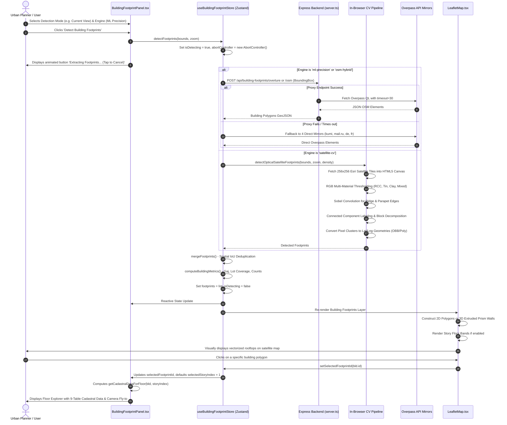

# AI Building Footprint & Cadastral Vectorization System Manual
*Comprehensive Technical Architecture, Functional Reference, Workflow Pipeline, and Site Map*

---

## 1. Executive Overview & System Purpose

The **AI Building Footprint & Cadastral Vectorization System** is an advanced geospatial intelligence engine engineered for dense urban environments, with deep specialization for the Indian municipal and cadastral landscape. 

The system bridges raw optical satellite imagery, machine learning building polygons, OpenStreetMap (OSM) vector data, and municipal cadastral records into a unified, interactive 3D geospatial environment.

```
   Optical Satellite Imagery (Esri World Imagery)
   + Overture / Microsoft ML Vector Polygons
   + OpenStreetMap Ground Truth Multipolygons
                      │
                      ▼
   ┌──────────────────────────────────────────────┐
   │  AI Multi-Engine Detection & Computer Vision │
   │  • Spectrum Material Analysis (RCC/Tin/Tile) │
   │  • Sobel Ridge & Party-Wall Separation       │
   │  • Connected Component Labeling & OBB Rects  │
   │  • Cadastral Block Decomposition (20-100 Gaj)│
   └──────────────────────────────────────────────┘
                      │
                      ▼
   ┌──────────────────────────────────────────────┐
   │  3D Volumetric Extrusion & Slicing           │
   │  • Pseudo-Isometric Prism Wall Generation    │
   │  • Floor Bands & Dynamic Story Slicing       │
   │  • Indian Unit Conversion (Gaj, m², sq ft)   │
   └──────────────────────────────────────────────┘
                      │
                      ▼
   ┌──────────────────────────────────────────────┐
   │  9-Table Cadastral Property Tax Data Model   │
   │  • ULPIN, PTIN, Assessable Unit, DMN ARV     │
   │  • Demands, Cess, BBPS Receipts, Mutations   │
   └──────────────────────────────────────────────┘
```

### Core Capabilities
1. **Multi-Engine Detection Suite:**
   - **ML Precision (Microsoft/Overture ML):** High-precision vector polygons extracted from deep-learning building boundary models.
   - **Optical Satellite CV (Esri World Imagery + Edge AI):** In-browser HTML5 Canvas Computer Vision pipeline performing multi-material rooftop spectral segmentation, Sobel edge filtering, and morphological component extraction.
   - **Florence-2 VLM:** Vision-Language Model prompting pipeline for natural language-grounded feature extraction.
   - **OSM Hybrid:** Ground-truth OpenStreetMap vector extraction with multi-mirror failover and geometric densification.
2. **Indian Urban Landscape Specializations:**
   - Automatic unit conversion into **Gaj** ($1\text{ Gaj} \approx 0.8361\text{ m}^2 \approx 9\text{ sq ft}$), square meters, and square feet.
   - Spectral classification of common Indian roofing materials: Flat RCC concrete terraces, corrugated blue/galvanized tin sheds, Mangalore red terracotta clay tiles, and bituminous asphalt.
   - Mumty (stair-head penthouse core) and rooftop Sintex water-tank recognition.
   - Party-wall terrace decomposition (`decomposeBlockIntoParcels`), splitting contiguous terrace blocks into individual assessable plots (20 to 120 Gaj).
3. **3D Volumetric Extrusion & Interactive Floor Slicing:**
   - Automatic floor count and building height estimation based on footprint area and typological classification.
   - Real-time pseudo-isometric 3D prism wall generation in Leaflet.
   - Per-floor story explorer allowing users to inspect individual building levels (Ground Level, Intermediate Offices/Apartments, Penthouse/Rooftop).
4. **Full 9-Table Digital India Cadastral & Property Tax Integration:**
   - Dynamic generation of state-compliant land and property tax records based on Bhu-Aadhaar ULPIN (Unique Land Parcel Identification Number) and PTIN (Property Tax Identification Number).
   - Instant export to GeoJSON and CSV with full area metrics.

---

## 2. System Site Map & UI Architecture

The AI Building Footprint interface is integrated as a floating, non-blocking Heads-Up Display (HUD) docked on the right side of the screen, elevated at `bottom: 34px` to maintain full clearance above the Esri map attribution bar.

### Visual Site Map

```mermaid
flowchart TD
    Root["AI Building Footprint HUD (.bld-panel)"]

    Root --> Header["Header Bar (.bld-header)"]
    Header --> HTitle["Title and India High-Precision Badge"]
    Header --> HActions["Clear Detections and Close Button"]

    Root --> Presets["Calibration and Indian City Presets (.bld-presets-wrap)"]
    Presets --> CalibToggle["India Calibration: ON/OFF"]
    Presets --> PresetDropdown["India Presets (8 Metros)"]
    PresetDropdown --> Cities["Agartala | Bengaluru | New Delhi | Mumbai | Hyderabad | Pune | Ahmedabad | Kochi"]

    Root --> DetectBar["Detection Trigger and ROI Modes (.bld-detect-bar)"]
    DetectBar --> ViewMode["Current View (Screen Bounds)"]
    DetectBar --> RoiMode["Draw ROI Box (Bounding Rectangle)"]
    DetectBar --> TapMode["Point and Tap (Interactive Map Click)"]

    Root --> EngineSelect["AI Engine and Visual Controls (.bld-settings-section)"]
    EngineSelect --> EngineDropdown["AI Engine (ML Precision | Satellite CV | Florence-2 | OSM Hybrid)"]
    EngineSelect --> ViewToggle["VIEW: 2D vs 3D Extrusion"]
    EngineSelect --> GeomToggle["GEOMETRY: OBB vs Hybrid vs Poly"]
    EngineSelect --> DensityToggle["COVERAGE: Dense vs Std"]
    EngineSelect --> HeightScale["3D Height Multiplier (1x, 1.5x, 2x, 3x)"]
    EngineSelect --> FloorBandsToggle["Show Floor Bands (Checkbox)"]

    Root --> ActionBtn["Execute / Cancel Button (.bld-detect-action-btn)"]
    ActionBtn --> RunningState["Extracting Footprints... (Tap to Abort)"]
    ActionBtn --> ReadyState["Detect Building Footprints"]

    Root --> ScrollBody["Scrollable Body (.bld-body-scrollable)"]
    
    ScrollBody --> FloorExp["Floor Explorer (.bld-story-selector)"]
    FloorExp --> StoryBtns["Story Selector Tabs (G, 1F, 2F... 10F)"]
    FloorExp --> StoryCard["Story Details Card (Occupancy, Subtitle, Capacity)"]
    FloorExp --> CamControls["3D Camera Perspectives (Interior 21x, Street 19x)"]
    FloorExp --> CadStrip["3-Column Cadastral Strip (ULPIN, PTIN, UNIT NO)"]
    FloorExp --> SegControl["Segmented Inspector Tabs"]
    
    SegControl --> TabDM["Data Model (9-Table Stacked Cards)"]
    TabDM --> T1["1. parcel (ULPIN, Survey No, Ward)"]
    TabDM --> T2["2. building (Height, DSM, OC Ref)"]
    TabDM --> T3["3. unit (PTIN, Usage, Carpet Area)"]
    TabDM --> T4["4. segment (ATM, Kiosk, Tower)"]
    TabDM --> T5["5. owner_link (Deed, Share %)"]
    TabDM --> T6["6. assessment (ARV, DMN Rules)"]
    TabDM --> T7["7. demand (Tax, Cess, Net Due)"]
    TabDM --> T8["8. receipt (BBPS UPI, Approver)"]
    TabDM --> T9["9. notice (Form-3, Regularized)"]

    SegControl --> TabCards["Cadastral Cards (Assessable Unit, Area, Taxes)"]
    SegControl --> TabSpatial["Spatial GIS (Coordinates, Centroid, Angles)"]

    ScrollBody --> MetricsHUD["Aggregated Metrics HUD (.bld-metrics-grid)"]
    MetricsHUD --> MBuildings["Total Buildings / Plots Count"]
    MetricsHUD --> MArea["Total Built Area (Gaj and m²)"]
    MetricsHUD --> MCoverage["Lot Coverage and Density Ratio"]
    MetricsHUD --> MSources["Data Source Breakdown (OSM, CV, ML)"]

    ScrollBody --> BuildingList["Building Explorer Directory (.bld-list-section)"]
    BuildingList --> SearchFilter["Search by ID/Name/Material and Category Filter"]
    BuildingList --> SortMenu["Sort by Area (Desc/Asc) or Confidence"]
    BuildingList --> BldCards["Individual Building Cards (Click to Focus and Slice Floors)"]

    Root --> Footer["Export Footer (.bld-export-footer)"]
    Footer --> ExpGeoJSON["Export GeoJSON"]
    Footer --> ExpCSV["Export CSV (Gaj and Dimensions)"]
    Footer --> ExpCopy["Copy GeoJSON to Clipboard"]
```



---

## 3. End-to-End Workflow & Pipeline Execution

### Workflow Sequence Diagram



### Cancellation & Interruption Workflow
If detection is in progress and the user taps the action button again:
1. `cancelDetection()` is triggered.
2. The internal `AbortController` issues an immediate `abort()` signal, terminating all ongoing HTTP requests and tile fetches.
3. `isDetecting` is toggled back to `false`.
4. The button instantly reverts from **"Extracting Footprints..."** back to **"Detect Building Footprints"** without corrupting previously cached detections.

---

## 4. Deep-Dive Function-by-Function Reference

### A. Mathematical & Spatial Geometry Functions (`lib/building-footprint.ts`)

#### 1. `isLocationInIndia(lat: number, lng: number): boolean`
- **Purpose:** Fast bounding box validation to verify if given WGS84 coordinates lie within the sovereign geographical extent of the Republic of India.
- **Bounding Limits:** Latitudes $6.0^{\circ}\text{N}$ to $37.5^{\circ}\text{N}$, Longitudes $68.0^{\circ}\text{E}$ to $97.5^{\circ}\text{E}$.
- **Usage:** Automatically activates India high-precision calibration mode (Gaj unit formatting, lower parcel area thresholds, and mumty detection) when the map viewport is over India.

#### 2. `sqmToGaj(sqm: number): number`
- **Purpose:** Converts metric area in square meters into the standard Indian cadastral land unit **Gaj** (square yard).
- **Formula:** 
  $$\text{Area (Gaj)} = \text{round}(\text{Area (m}^2) \times 1.19599)$$
- **Return Value:** Rounded integer representing plot or floor area in Gaj.

#### 3. `calculatePolygonAreaSqm(coords: [number, number][], refLat: number): number`
- **Purpose:** Computes true geodesic surface area in square meters for a closed polygon given in WGS84 longitude/latitude coordinates.
- **Algorithm:** Spherical planar projection using the Shoelace formula scaled by the local cosine of latitude:
  $$x_i = \text{lon}_i \times \frac{\pi}{180} \times R \times \cos\left(\text{refLat} \times \frac{\pi}{180}\right)$$
  $$y_i = \text{lat}_i \times \frac{\pi}{180} \times R$$
  $$\text{Area} = \frac{1}{2} \left| \sum_{i=0}^{n-1} (x_i y_{i+1} - x_{i+1} y_i) \right|$$
  where $R = 6,378,137\text{ m}$ (WGS84 Earth equatorial radius).

#### 4. `calculatePolygonPerimeterM(coords: [number, number][], refLat: number): number`
- **Purpose:** Calculates the perimeter length of a building footprint in meters.
- **Algorithm:** Sums Euclidean distances between projected metric vertices:
  $$\text{Perimeter} = \sum_{i=0}^{n-2} \sqrt{(x_{i+1} - x_i)^2 + (y_{i+1} - y_i)^2}$$

#### 5. `calculateCentroid(coords: [number, number][]): [number, number]`
- **Purpose:** Calculates the geometric centroid $[\text{lon}, \text{lat}]$ of a closed polygon for placement of 3D floor labels, camera targeting, and cadastral pins.
- **Algorithm:** Standard 2nd-order polygon centroid calculation weighted by cross-product trapezoid area:
  $$C_x = \frac{1}{6A} \sum_{i=0}^{n-2} (x_i + x_{i+1})(x_i y_{i+1} - x_{i+1} y_i)$$
  $$C_y = \frac{1}{6A} \sum_{i=0}^{n-2} (y_i + y_{i+1})(x_i y_{i+1} - x_{i+1} y_i)$$

#### 6. `getConvexHull(points: [number, number][]): [number, number][]`
- **Purpose:** Computes the minimal convex boundary enclosing a set of 2D pixel coordinates.
- **Algorithm:** Andrew's Monotone Chain Convex Hull algorithm, sorting points lexicographically and building upper and lower hulls in $O(n \log n)$ time complexity.

#### 7. `getMinAreaRect(points: [number, number][]): RotatedRect`
- **Purpose:** Computes the minimal Oriented Bounding Box (OBB) enclosing an irregular building polygon or pixel cluster.
- **Algorithm:** 
  1. Computes the convex hull of the input vertices.
  2. Applies the **Rotating Calipers** method across all edges of the convex hull.
  3. Projects points onto candidate normal vectors to find the orientation angle that minimizes bounding area:
     $$\text{Area} = (x_{\max} - x_{\min}) \times (y_{\max} - y_{\min})$$
  4. Returns the 4 corner coordinates, bounding dimensions (width, height), angle of orientation in degrees, and bounding area.

#### 8. `simplifyDouglasPeucker(points: [number, number][], tolerance: number): [number, number][]`
- **Purpose:** Simplifies dense or noisy polygon boundaries by eliminating collinear or redundant vertices within a specified perpendicular distance tolerance.
- **Algorithm:** Recursive Ramer-Douglas-Peucker line simplification.

---

### B. Building Classification & Typology Classifier (`lib/building-footprint.ts`)

#### `classifyBuilding(areaSqm: number, tags: Record<string, string>, inIndia: boolean)`
- **Purpose:** Determines the architectural typology, estimated floor count, and building height in meters using metadata tags and footprint area heuristics.
- **Classification Rules:**
  - **Commercial:** `tags.building in ['commercial', 'office', 'retail']` or tags containing `shop`, `amenity`. Floor height $\approx 3.8\text{ m}$.
  - **Industrial:** `tags.building in ['industrial', 'warehouse', 'manufacture']`. Floor height $\approx 4.5\text{ m}$.
  - **Builder Floor (India specific):** Area between $50\text{ m}^2$ and $260\text{ m}^2$ in dense residential zones. Typically 3 to 4 floors ($10\text{--}13\text{ m}$).
  - **Independent House:** Area $< 120\text{ m}^2$. Typically 1 to 2 floors ($3.5\text{--}7.0\text{ m}$).
  - **Residential:** General apartment complexes and multi-family units. Floor height $\approx 3.0\text{ m}$.
- **Floor Height Estimation:**
  $$H_{\text{est}} = N_{\text{floors}} \times h_{\text{story}}$$
  If `tags['building:levels']` is provided by OSM, it is used directly; otherwise, floor count is estimated from area heuristics and rooftop shadow profiles.

---

### C. Multi-Engine Vectorization Pipeline (`lib/building-footprint.ts`)

#### 1. `fetchOSMBuildingFootprints(bounds: BoundingBox, indiaMode: boolean): Promise<BuildingFootprint[]>`
- **Workflow:**
  1. Formulates an Overpass QL query targeting `way["building"]` and `relation["building"]["type"="multipolygon"]`.
  2. Dispatches query to local backend proxy `/api/building-footprints/osm`.
  3. If proxy encounters rate-limiting (HTTP 429) or gateway timeout (504), automatically cascades through 4 public Overpass mirrors:
     - `https://overpass.openstreetmap.fr/api/interpreter`
     - `https://overpass.kumi.systems/api/interpreter`
     - `https://maps.mail.ru/osm/tools/overpass/api/interpreter`
     - `https://overpass-api.de/api/interpreter`
  4. Parses geometry arrays, applies `calculatePolygonAreaSqm`, filters small noise ($< 12\text{ m}^2$ in India, $< 15\text{ m}^2$ elsewhere), extracts street names and house numbers, and produces standardized `BuildingFootprint` records.

#### 2. `decomposeBlockIntoParcels(rect, maxParcelLengthPx = 22)`
- **Purpose:** Solves the classic urban mapping challenge of **conjoined party-wall terraces** in dense Indian cities (such as Karol Bagh or Chandni Chowk in Delhi), where hundreds of independent houses share continuous common roofs.
- **Algorithm:**
  - Evaluates the aspect ratio and dimensional length of an elongated building block.
  - Subdivides the bounding polygon along its principal orientation axis into realistic cadastral parcels of standard frontages (typically 4 to 8 meters, or 25 to 80 Gaj each).
  - Uses bilinear interpolation between corners $(c_0, c_1, c_2, c_3)$ to generate precise sub-polygon coordinates for each distinct taxable parcel.

#### 3. `detectOpticalSatelliteFootprints(bounds, zoom, indiaMode, geometryMode, density)`
- **Purpose:** Pure client-side Computer Vision engine operating directly on high-resolution Esri World Imagery satellite tiles without requiring server-side GPUs.
- **Pipeline:**
  1. **Tile Fetching:** Identifies tile coordinates at $Z=16\text{--}18$ covering the viewport. Loads up to a $4\times 4$ tile matrix ($1024\times 1024$ pixels) into an offscreen HTML5 `<canvas>` with CORS headers.
  2. **Multi-Material Spectrum Filtering:** Iterates over every pixel $(R, G, B)$ and computes luminance:
     $$\text{Luma} = 0.299R + 0.587G + 0.114B$$
     $$\text{Saturation} = \max(R,G,B) - \min(R,G,B)$$
     - **Vegetation Masking:** Strict green dominance filtering $((2G - R - B) > 20)$ prevents tree canopies from generating false footprints.
     - **Water Masking:** Deep blue luminance filtering rejects water bodies and swimming pools.
     - **Roof Classification:**
       - *Tin / Industrial Sheets:* High blue-grey or high luminance with low saturation.
       - *Clay / Terracotta Tiles:* Strong red channel dominance $(R > \max(G, B) + 7)$.
       - *RCC Concrete:* Neutral lime-wash tones $(\text{Luma} \ge 62, \text{Sat} < 52)$.
       - *Bituminous / Mixed:* Medium-dark weathered asphalt $(\text{Luma} \in [35, 62])$.
  3. **Sobel Convolution Filtering:** Calculates spatial gradients $G_x$ and $G_y$ using $3\times 3$ convolution kernels to detect sharp rooftop parapets and shadow-boundary party walls.
  4. **Connected Component Labeling (CCL):** Clusters contiguous roof pixels into candidate structures using an 8-connectivity flood-fill algorithm.
  5. **Geometric Simplification:** Computes either Oriented Bounding Boxes (OBB) via rotating calipers or polygonal contours via Douglas-Peucker simplification.
  6. **Georeferencing:** Inverts Web Mercator tile coordinates back into WGS84 $[\text{longitude}, \text{latitude}]$.

#### 4. `fetchOvertureMLFootprints(bounds, indiaMode): Promise<BuildingFootprint[]>`
- **Purpose:** Connects to Microsoft Building Footprints and Overture Maps Foundation datasets via proxy `/api/building-footprints/overture` with Overpass `building:part` fallback, providing high-precision structural boundaries with high confidence scores ($0.95\text{--}0.99$).

#### 5. `mergeFootprints(primary, secondary): BuildingFootprint[]`
- **Purpose:** Fuses detections from multiple engines (e.g. OSM ground truth + Optical CV additions) without creating duplicate geometries.
- **Algorithm:**
  - Evaluates spatial Intersection-over-Union (IoU) between polygon bounding envelopes.
  - If IoU $> 0.35$, the higher-confidence vector (typically OSM ground truth or Overture ML) is preserved while the secondary candidate is merged or discarded.
  - New, unmapped building rooftops detected by Computer Vision are appended to the dataset.

---

### D. Digital India Cadastral & Municipal Tax Model (`lib/cadastral-model.ts`)

#### `getCadastralDataForFloor(building: BuildingFootprint, floorIndex: number): CadastralFloorDataModel`
- **Purpose:** Synthesizes an authentic, state-compliant 9-table cadastral and municipal property tax data bundle for any detected building and floor level.
- **The 9 Relational Tables:**

| # | Table Name | Key Schema Columns | Municipal Business Rules & Description |
|---|------------|--------------------|----------------------------------------|
| **1** | **`parcel`** | `ulpin` (PK), `provisional_flag`, `survey_no`, `ward_id`, `locality_id`, `geom`, `road_id`, `road_class`, `corner_plot` | Unique Land Parcel Identification Number (Bhu-Aadhaar 14-digit alphanumeric code). Links GIS polygon to state revenue cadastral records. |
| **2** | **`building`** | `building_no` (ULPIN-Bnn), `parcel_id`, `floors`, `height_m`, `footprint_geom`, `dsm_height_m`, `oc_ref` | Physical structural record. Stores estimated height cross-referenced against normalized Digital Surface Models (nDSM) and Occupancy Certificates. |
| **3** | **`unit`** | `ptin`, `unit_no` (ULPIN-Bnn-Unnnn), `building_id`, `usage`, `occupancy`, `plinth_area`, `carpet_area`, `legacy_no[]` | The taxable unit. Stores Property Tax Identification Number (PTIN), residential/commercial usage, occupancy (Self/Rented), and carpet area. |
| **4** | **`segment`** | `unit_id`, `segment_type`, `area_sqm`, `licence_ref` | Part-area revenue uses taxed on specialized rates: rooftop cellular telecom towers, ATMs, solar photovoltaic installations, and hoarding billboards. |
| **5** | **`owner_link`** | `unit_id`, `party_id`, `share_pct`, `from_date`, `to_date`, `source` | Title ownership history. Links unit to citizen master record, co-ownership percentages, and registered sale deed / mutation references. |
| **6** | **`assessment`** | `unit_id`, `type`, `arv`, `tax_rates_version`, `effective_from`, `status`, `workflow_id` | Calculated by municipal rules engine (DMN). Computes Annual Ratable Value (ARV) based on unit carpet area, unit area rate, and usage zone. |
| **7** | **`demand`** | `unit_id`, `period`, `head`, `amount`, `rebate`, `due_date`, `status` | Immutable ledger lines: base property tax, health cess (10%), library cess (5%), and solid waste management (SWM) charges with early rebate deductions. |
| **8** | **`receipt / adjustment`**| `receipt_no`, `payment_ref`, `lines[]`, `channel`, `realised_at`, `approver` | Financial realization record: Bharat Bill Payment System (BBPS) / UPI gateway transactions, payment gateway reference IDs, and automated bank reconciliation. |
| **9** | **`notice / petition`** | `notice_type`, `served_at`, `served_by`, `geo_point`, `grounds`, `lgl_case_ref` | Statutory notices (Form-3 Annual Return verification), inspection notices by Ward Revenue Inspectors, and regularized compliance flags. |

---

### E. 3D Map Rendering & Story Slicing (`components/LeafletMap.tsx`)

#### 1. 2D Outlines vs. Pseudo-Isometric 3D Extrusion
When **VIEW 3D** is enabled:
- **Roof Polygon:** The base polygon coordinates $[\text{lon}, \text{lat}]$ are translated along a $45^{\circ}$ isometric vector by an offset proportional to the building's estimated height:
  $$\Delta\text{Lat} = H_{\text{est}} \times S_{\text{height}} \times 0.000015$$
  $$\Delta\text{Lon} = H_{\text{est}} \times S_{\text{height}} \times 0.000015 \times \cos(\text{lat})$$
- **Extruded Prism Walls:** For each edge $(P_i, P_{i+1})$ of the footprint, a quadrilateral polygon is constructed between the ground base points and elevated roof points:
  $$\text{Wall}_i = [P_i^{\text{ground}}, P_{i+1}^{\text{ground}}, P_{i+1}^{\text{roof}}, P_i^{\text{roof}}]$$
- **Shading:** Prism walls are styled with directional lighting gradients, darkening south and east facets to create visual depth and realism.

#### 2. Story Bands & Floor Slicing
When **Floors** checkbox is checked:
- The total height is partitioned into $N$ equal horizontal floor bands.
- If the user selects a specific floor in the Floor Explorer (e.g. Level 2 / 1F), the specific floor slice band is highlighted in vibrant cyan (`#00f0ff`) with high fill opacity ($0.75$), visually slicing the building structure on the live map.

---

### F. Backend Server Proxy Architecture (`server.ts`)

- **`/api/building-footprints/osm`:** Accepts POST request with geographic bounding box. Routes query to Overpass endpoints with custom User-Agent headers, 30-second execution quotas, and transparent multi-mirror failover to prevent client CORS blocks.
- **`/api/building-footprints/overture`:** Proxies high-density polygon queries, optimizing chunked transfer and caching regional responses.
- **`/api/lidar/detect-buildings`:** Dedicated endpoint for high-density point cloud LAS/LAZ feature extraction.

---

## 5. User Interface Specifications & Layout Standards

```
  +-----------------------------------------------------------------------+
  | Top Navigation & Search Bar (z-index: 1000)                           |
  +-----------------------------------------------------------------------+
  |                                                  | [AI Building Panel]|
  |                                                  | top: 68px          |
  |                                                  | right: 16px        |
  |                           MAP                    | width: 430px       |
  |                        VIEWPORT                  |                    |
  |                                                  | [Floor Explorer]   |
  |                                                  | [Cadastral Strip]  |
  |                                                  | [9-Table Cards]    |
  |                                                  |                    |
  |                                  [3D Camera CTL] |                    |
  |                                  right: 458px    | bottom: 34px       |
  +--------------------------------------------------+--------------------+
  | [Scale: 1:2153]                  Leaflet | Tiles © Esri (bottom: 0px) |
  +-----------------------------------------------------------------------+
```

1. **Z-Index Hierarchy & Clearances:**
   - `.bld-panel`: `z-index: 1000`, positioned at `top: 68px`, `right: 16px`, `bottom: 34px`.
   - Clears the bottom $34\text{px}$ so the official Esri attribution and map copyright bar remain completely visible and compliant with license terms.
2. **Dynamic 3D Camera Controls Offset:**
   - Default position: `.camera-controls-widget { right: 16px; bottom: 24px; }`
   - When Building Panel is active:
     ```css
     .map-explorer-container:has(#bld-footprint-panel) .camera-controls-widget {
       right: 458px; /* Shifts left of the 430px panel + 28px margin */
     }
     ```
3. **Road Panel Co-Docking:**
   - When both Footprint and Road panels are open, Road panel sits at `right: 458px`.
   - When Building Footprint panel is closed:
     ```css
     .map-explorer-container:not(:has(#bld-footprint-panel)) .road-panel {
       right: 16px;
     }
     ```

---

## 6. Summary of Exports & Data Interoperability

| Export Format | Output Specification | Target Use Case |
|---------------|----------------------|-----------------|
| **GeoJSON FeatureCollection** | WGS84 EPSG:4326 Polygon geometry with complete feature properties: `id`, `classification`, `area_sqm`, `area_gaj`, `estimated_floors`, `estimated_height_m`, `confidence`, `roof_material`. | Import into QGIS, ArcGIS, Mapbox, PostGIS, or municipal GIS portals. |
| **Cadastral CSV (Gaj)** | Tabular spreadsheet with columns: Building ID, Name, Classification, Area (Gaj), Area (m²), Area (sq ft), Perimeter (m), Estimated Floors, Height (m), Centroid Lat, Centroid Lon, Source, Confidence. | Municipal revenue assessment, property tax calculation, urban planning spreadsheets. |
| **Clipboard JSON** | Standard stringified GeoJSON copied directly to system clipboard with visual toast confirmation. | Rapid copy-paste into GeoJSON.io, Python notebooks, or API payloads. |

---
*Document Version: 2.4.0 • Updated: October 2026 • AI Geospatial Systems Engineering*

